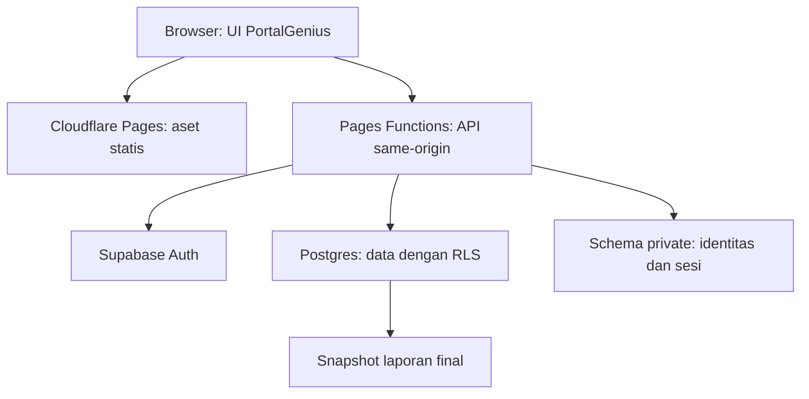

# PortalGenius — Arsitektur

Status: rancangan implementasi v1.0, 14 Oktober 2026. Tidak ada infrastruktur yang sudah dikonfigurasi oleh paket ini.

## Topologi dan pilihan
Satu aplikasi modular, satu repository baru, satu lembaga. React + TypeScript + Vite untuk UI; Cloudflare Pages menyajikan aset, Pages Functions sebagai backend-for-frontend (BFF); Supabase Auth dan PostgreSQL pada proyek baru milik lembaga. Browser hanya memanggil API same-origin; token Supabase tidak diserahkan ke JavaScript browser. Tidak memerlukan microservices, Redis, SSR atau realtime.

| Lapisan | Pilihan rancangan | Alasan/alternatif | Keputusan |
|---|---|---|---|
| UI | React, TypeScript strict, Vite | Selaras referensi jurnal; Next.js/SSR tidak diperlukan untuk portal internal | ADR-002 |
| Navigasi/form | React Router, React Hook Form, Zod | Navigasi dan validasi jelas; versi kompatibel dikunci saat M-001 | ADR-002 |
| UI kit | CSS tokens, primitive Radix seperlunya, Lucide SVG | Semantik dan konsistensi; hindari menambah dua library komponen | ADR-003 |
| Backend | Pages Functions TypeScript, Web APIs | API same-origin dan cookies; tidak menganggap seluruh Node API tersedia | ADR-002 |
| Identitas/data | Supabase Auth + Postgres/RLS | Password dikelola provider; D1 memerlukan rancangan identitas berbeda | ADR-004 |
| Ekspor | Browser lazy-load @react-pdf/renderer dan ExcelJS | Menghindari headless browser di server; validasi bundle dan layout pada M-006 | ADR-007 |
| Tes | Vitest, Testing Library, Playwright, axe-core; SQL integration | Uji aturan dan batas akses, bukan snapshot implementasi | ADR-002 |

Dependensi adalah pilihan rancangan, belum terpasang. Pin versi pasti yang saling kompatibel dan catat runtime Node LTS yang didukung Cloudflare pada M-001; jangan menyalin versi dari jurnal lama.

## Struktur yang direncanakan
Path berikut belum berupa file implementasi. Tautan dokumen tetap menunjuk file yang ada.

| Path | Pemilik tanggung jawab |
|---|---|
| src/app/ | Bootstrap, routes, provider, shell; tanpa logika bisnis |
| src/features/auth/ | Login, ganti password, UI sesi |
| src/features/academics/ | Master, periode, kelompok, penugasan |
| src/features/journals/ | Wizard, draft, peserta, histori |
| src/features/grades/ | Editor nilai, kebijakan bobot |
| src/features/development/ | Sikap bulanan, konselor |
| src/features/reports/ | Pemilih siswa, review, viewer, unduhan |
| src/features/dashboard/ | Ringkasan sesuai peran |
| src/shared/ui/ dan src/shared/styles/ | Primitive dan design tokens |
| domain/ | Fungsi murni aturan nilai, kehadiran, status laporan |
| contracts/ | DTO dan validator API per fitur, tanpa kode rahasia |
| server/auth/ | Verifikasi sesi, username resolver, password lifecycle |
| server/features/ | Use case dan repository per modul |
| server/platform/ | Supabase clients, crypto, cookie, logging |
| functions/api/v1/ | File route tipis satu endpoint/tanggung jawab |
| supabase/migrations/ | Migrasi urut, RLS, RPC transaksi |
| tests/ | Unit, API/DB integration, E2E |

UI -> hook/use case -> API adapter. Route -> autentikasi/otorisasi -> use case -> repository/RPC. Domain tidak mengimpor React, Supabase, Cloudflare atau environment. Validator kontrak dapat dipakai UI/server; keputusan akses selalu di server/database. Repositori mengimplementasikan kontrak sempit. Tiap modul menulis tabel miliknya; reports membaca proyeksi terotorisasi dan memiliki snapshot, bukan mengedit nilai.

## Username dan sesi
Supabase password Auth menggunakan identitas email/telepon, bukan username native. Solusi rancangan: admin membuat auth user dengan alias internal unik berbasis UUID; schema private menyimpan username_normalized -> auth_user_id -> alias. Tidak meminta email pribadi pengguna. Alias tidak menjadi kanal pemulihan atau ditampilkan UI. Admin API melakukan provisioning yang dapat dipulihkan bila sebagian gagal; user belum berstatus aktif sampai semuanya selesai. Verifikasi alias internal yang diterima provider pada M-001; kegagalan harus dibahas, bukan mengganti UI menjadi login email diam-diam.

BFF menerima username/password lewat HTTPS, membatasi percobaan per IP dan username, menyelesaikan alias secara privat, lalu meminta Auth memverifikasi password. Password tidak disimpan aplikasi. Hasil login menghasilkan cookie opaque acak minimal 256-bit `__Host-pg_session`, HttpOnly, Secure, SameSite=Lax, Path=/ tanpa Domain. Simpan hash session handle, auth user, expiry dan token Supabase terenkripsi AES-GCM di private.app_sessions. Kunci enkripsi di secret Cloudflare; rancang versi kunci untuk rotasi. TTL awal usulan 8 jam absolut, idle 60 menit. BFF memverifikasi token lewat provider, memeriksa sesi serta akun aktif, lalu memakai user JWT pada query normal agar RLS berlaku.

Refresh token diserialkan dengan lease database/version untuk mencegah dua refresh paralel merusak sesi. Logout menghapus cookie dan mencabut app_session. Reset password menandai akun wajib ganti, mencabut semua app_session lama dan meminta pencabutan sesi provider; jangan mengandalkan perubahan password saja untuk membatalkan access token. App_session menjadi penghalang akses segera bagi seluruh API. Endpoint ganti password adalah pengecualian terbatas saat must_change_password aktif.

Reset oleh admin menghasilkan password sementara acak yang hanya ditampilkan sekali, tidak dicatat audit. Pengguna wajib menggantinya sebelum mengakses data. Admin memverifikasi identitas secara operasional; tidak menyediakan recovery email publik. Admin awal diprovision oleh operator melalui script server-only, bukan endpoint bootstrap publik. Recovery admin terakhir memerlukan operator proyek, tercatat dan diuji.

## Batas akses
Service secret hanya pada helper provisioning, pemetaan username, app_sessions, rate limiting dan operasi administratif spesifik. Query data sekolah menggunakan user JWT; tidak memakai service secret untuk seluruh request. RLS deny by default pada semua tabel public. Policies memeriksa active account, role dan penugasan; user_metadata tidak menentukan peran. Role disimpan di tabel terkontrol. Tabel private tidak diekspos Data API. Akses BFF ke tabel private memakai RPC sempit yang hanya diberi EXECUTE ke service_role, bukan mengekspos schema private atau endpoint CRUD generik. Payload dan identitas diperiksa di helper server; cabut EXECUTE dari PUBLIC, anon dan authenticated. Helper SQL security definer bila diperlukan untuk policy anti-recursion: search_path tetap, minimal privilege, tidak dapat dipanggil sembarang role. RPC finalisasi memvalidasi admin dan menjaga snapshot atomik.

## Runtime inti
- Simpan jurnal: route autentikasi -> validator -> cek penugasan -> RPC satu transaksi membuat jurnal/peserta -> audit -> respons. DB uniqueness mengamankan idempotency, bukan hanya tombol disabled.
- Nilai: API memeriksa penugasan -> optimistic version -> simpan score dan audit atomik. Rerata kategori lalu bobot; hasil perhitungan SQL final dibanding domain TypeScript dengan fixture yang sama.
- Finalisasi: baca draft dan revision sumber, cek kelengkapan, RPC mengambil snapshot transaksi konsisten, validasi revision, tulis report version serta audit. Jika sumber berubah sejak preview, return 409 dan minta refresh. Tidak menerbitkan preview basi.
- Ekspor: server mengirim snapshot final terotorisasi, browser membuat PDF/XLSX tanpa meminta layanan pihak ketiga. URL tidak berisi identitas/kredensial; revoke Blob URL setelah selesai. Draft diberi watermark DRAFT.

## Keandalan, keamanan dan operasi
API /api/v1 harus selalu JSON termasuk 404; jangan jatuh ke SPA fallback. Response sensitif Cache-Control: no-store, tidak masuk CDN/service worker. GET tidak mengubah data. Mutation memerlukan Origin allowlist dan token CSRF terikat sesi. CSP restrict sumber skrip, no iframe, no inline HTML dari catatan; encode output. API body limit, timeout 10 detik, error ID tanpa data pribadi. Login rate limit atomik di database, bukan memori instance; fail closed bila pembatasan tak tersedia. Audit tidak merekam teks konselor/token/password.

Backup operator terenkripsi harian (usulan RPO 24 jam, RTO 1 hari kerja), termasuk snapshot. Simpan akses terbatas terpisah dari repo. Buktikan restore ke lingkungan sintetis; ekspor PDF bukan backup database. Monitor pemakaian layanan, failure API dan waktu ekspor tanpa telemetry isi catatan siswa. Tidak mengklaim backup otomatis pada paket gratis.

## Lingkungan dan deploy
Local: Supabase lokal dengan data sintetis, Pages Functions lokal + Vite. Staging: Pages staging dan proyek Supabase khusus uji jika jatah tersedia. Production: proyek lembaga dan hostname Pages final. Preview PR tidak memakai secrets/data produksi; tanpa staging cloud, preview UI sintetis dan integrasi lokal sampai gate hosted bisa dilakukan. Akun/proyek/slot belum diverifikasi.
Build `npm run build`, output dist; Functions dipaketkan terpisah sesuai Pages. API route tidak dicache. Static hashed assets boleh immutable. CI membuat artefak setelah lint/type/unit/integration/build; hosted deploy harus didahului gate terkait pada [testing](./testing.md). Tidak memindahkan target ke Workers-only tanpa keputusan pemilik karena pages.dev adalah kebutuhan eksplisit.

## Risiko dan tradeoff
BFF sesi menambah pekerjaan tetapi memenuhi username-only tanpa token di browser. Free tier bukan SLA dan wajib dipantau. Ekspor browser memerlukan uji memori HP serta pagination; jika gagal, bandingkan alternatif server dalam ADR sebelum mengubah desain. Tak ada Google Apps Script atau integrasi jurnal lama pada runtime baru.

Sumber resmi dan status verifikasi ada di [decisions](./decisions.md). Kontrak: [schema](./schema.md).